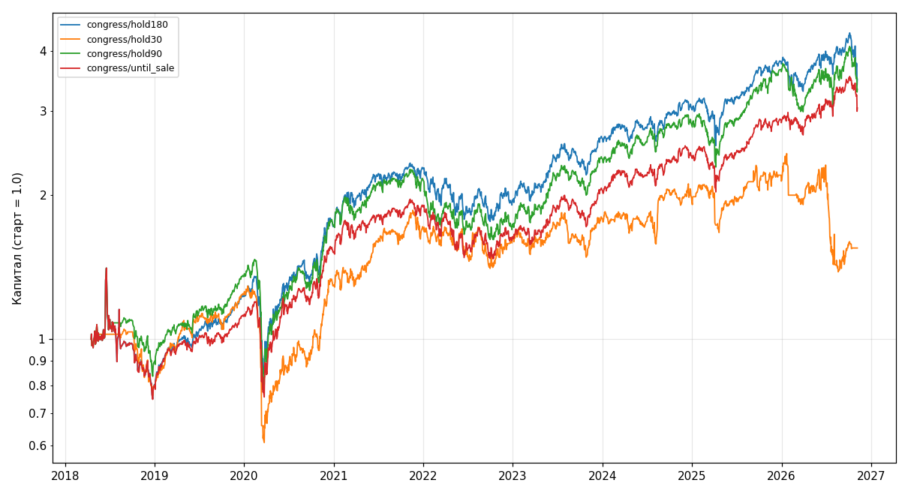

# Бэктест: Copycat 13F и сделки Конгресса

Обновлено: 2026-11-08T12:27:41Z

> - Не финансовый совет. Это проверка правил на прошлых данных, а не прогноз.
> - 13F выходит до 45 дней после конца квартала и показывает только длинные позиции в акциях США.
> - PTR подают до 45 дней после сделки, суммы указаны диапазонами. Учтены только акции, опционы пропущены.
> - Комиссии, проскальзывание и налоги не учтены.
> - Ошибка выжившего: по делистингованным тикерам цен часто нет, такие сделки в колонке «Без цены».
> - Сделки в статусе «Открыто» оценены по последней цене и в доли выигрышных не входят.
> - Copycat: вес позиций без цены делится между остальными позициями периода, а не держится в кэше.
> - Конгресс: свободные деньги лежат в кэше под 0 %, поэтому CAGR занижен относительно всегда вложенного SPY.

## Итог по стратегиям

| Стратегия | Вариант | Закрыто сделок | Доля в плюсе, % | Доля лучше SPY, % | Средняя, % | Медиана, % | Избыток над SPY, % | Открыто | Без цены | С | По | CAGR, % | CAGR SPY, % | Просадка, % | Просадка SPY, % |
|---|---|---|---|---|---|---|---|---|---|---|---|---|---|---|---|
| congress | hold180 | 1189 | 66.7 | 52.6 | 11.4 | 8.9 | 2.3 | 37 | 101 | 2018-04-17 | 2026-11-06 | 15.8 | 14.1 | -46.7 | -33.7 |
| congress | hold30 | 1220 | 56.5 | 52.1 | 1.4 | 1.6 | 0.5 | 6 | 101 | 2018-04-17 | 2026-11-06 | 5.3 | 14.1 | -52.9 | -33.7 |
| congress | hold90 | 1206 | 60.7 | 52.6 | 6.4 | 4.1 | 2.0 | 20 | 101 | 2018-04-17 | 2026-11-06 | 15.1 | 14.1 | -45.5 | -33.7 |
| congress | until_sale | 1180 | 58.6 | 47.5 | 8.6 | 4.5 | 0.2 | 46 | 101 | 2018-04-17 | 2026-11-06 | 13.9 | 14.1 | -46.8 | -33.7 |

## Copycat по фондам

_нет данных_

## Конгресс по членам Палаты

| Вариант | Источник | Закрыто сделок | Доля в плюсе, % | Доля лучше SPY, % | Средняя, % | Медиана, % | Избыток над SPY, % | Открыто | Без цены |
|---|---|---|---|---|---|---|---|---|---|
| hold180 | Gottheimer | 1040 | 64.1 | 51.4 | 9.8 | 8.5 | 0.9 | 33 | 77 |
| hold180 | Mark Green | 108 | 94.4 | 67.6 | 30.0 | 18.2 | 17.8 | 0 | 24 |
| hold180 | Meuser | 19 | 36.8 | 36.8 | -3.9 | -1.5 | -5.9 | 1 | 0 |
| hold180 | Pelosi | 22 | 77.3 | 45.5 | 7.0 | 6.8 | 1.3 | 3 | 0 |
| hold30 | Gottheimer | 1067 | 56.4 | 52.2 | 1.1 | 1.5 | 0.3 | 6 | 77 |
| hold30 | Mark Green | 108 | 53.7 | 50.9 | 4.6 | 1.2 | 2.0 | 0 | 24 |
| hold30 | Meuser | 20 | 60.0 | 60.0 | -1.0 | 2.7 | -1.4 | 0 | 0 |
| hold30 | Pelosi | 25 | 68.0 | 48.0 | 6.5 | 2.4 | 3.7 | 0 | 0 |
| hold90 | Gottheimer | 1056 | 59.8 | 50.9 | 5.6 | 3.4 | 1.3 | 17 | 77 |
| hold90 | Mark Green | 108 | 70.4 | 69.4 | 14.8 | 13.4 | 8.7 | 0 | 24 |
| hold90 | Meuser | 20 | 40.0 | 40.0 | 2.3 | -2.7 | -2.1 | 0 | 0 |
| hold90 | Pelosi | 22 | 72.7 | 63.6 | 7.5 | 6.7 | 4.1 | 3 | 0 |
| until_sale | Gottheimer | 1031 | 57.5 | 45.5 | 8.5 | 3.8 | -0.4 | 42 | 77 |
| until_sale | Mark Green | 108 | 79.6 | 65.7 | 12.9 | 11.9 | 7.2 | 0 | 24 |
| until_sale | Meuser | 19 | 0.0 | 36.8 | -12.2 | -8.3 | -7.9 | 1 | 0 |
| until_sale | Pelosi | 22 | 59.1 | 59.1 | 9.1 | 11.1 | 3.2 | 3 | 0 |

## Данные

Проблем при сборе данных: 412 (подробно в `errors.log`).
Все сделки: `trades.csv`. Машиночитаемая сводка: `summary.json`.
